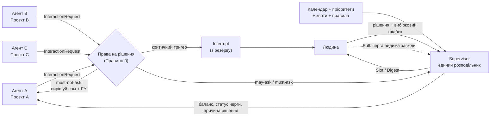
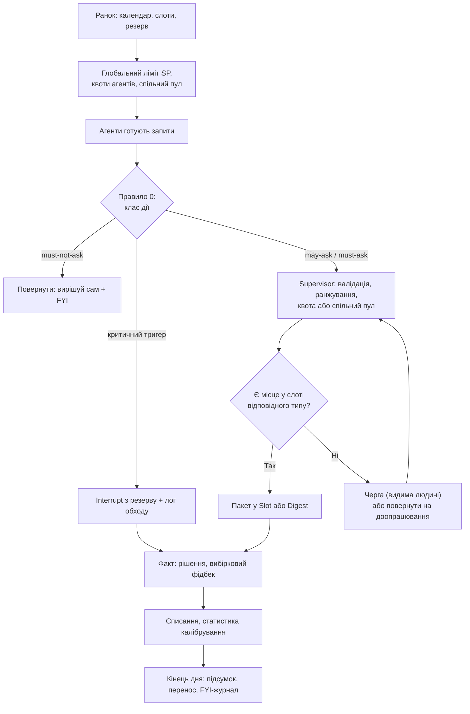
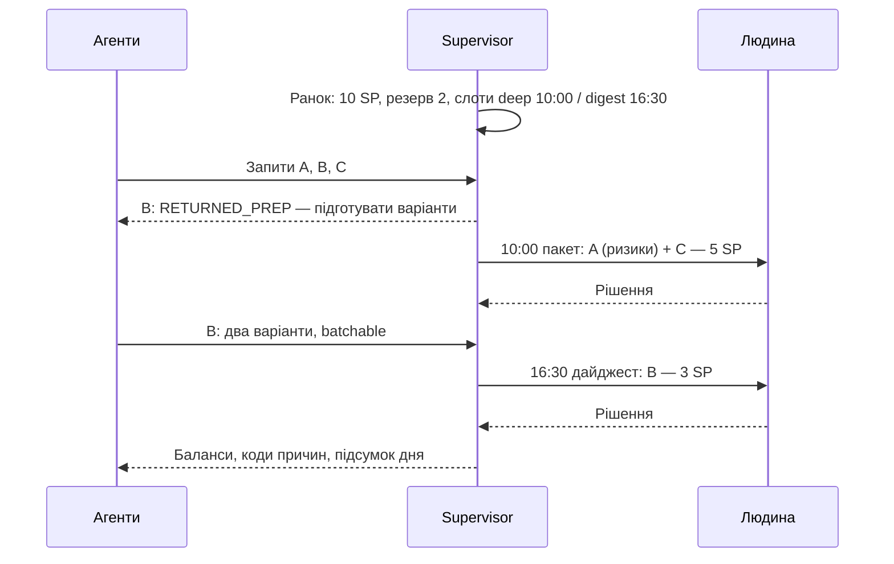

# Agent Attention Game

**Ігрова модель керування увагою людини для мультиагентної AI-системи**  
Версія: 0.2 — узгоджена редакція після рев'ю · 12 жовтня 2026 року  
Статус: **гіпотеза / дизайн-пропозиція, не перевірена практикою**

> **Що змінилося від v0.1.** Прибрано суперечності між правилами (два механізми розподілу, дві одиниці виміру, невизначене списання), додано правила, без яких механіка небезпечна (права на рішення, закритий список критичних тригерів, ціна перемикання контексту, мінімальна ціна для ризикових рішень), а план перевірки доповнено діагностикою та абляцією. Повний перелік змін — у [Додатку A](#додаток-a-журнал-змін-v01--v02).

## 1. Executive summary

У системі працюють незалежні AI-агенти: кожен має контекст свого проєкту, намагається покращувати його бізнес-результат і періодично потребує рішень або дій людини. Агенти не бачать усієї картини, тому можуть одночасно надсилати багато запитів, змагатися за увагу та погіршувати загальну ефективність.

**Дві різні проблеми, які легко сплутати:**

1. **Поріг ескалації** — агент питає те, що мав вирішити сам або не питати взагалі. Лікується правами на рішення (Правило 0) і шаблоном запиту, а не економікою.
2. **Конкуренція за увагу** — кілька агентів одночасно претендують на обмежений час людини. Саме тут доречні черга, слоти й бюджети.

Ігрова економіка (цей документ) адресує переважно другу проблему. Тому вона є **одним із варіантів**, і її слід впроваджувати лише після того, як дані покажуть, що простіші заходи не дають потрібного ефекту (див. розділ 6).

**Пропозиція:** перетворити доступ до уваги людини на обмежений ресурс в **одній одиниці — attention points (SP)**. Ціна взаємодії складається з **фіксованої вартості перемикання контексту** та **когнітивної складності** кожного пункту. **Supervisor** — єдиний розподільник: він знає глобальні пріоритети, календар і правила, перевіряє запити, пакує їх у слоти й визначає формат доставки. Бюджети агентів — це **квоти на гарантоване право претендувати** на увагу, а не окрема валюта.

**Головна мета:** підвищити бізнес-цінність на одиницю людської уваги, водночас зменшивши кількість переривань і когнітивне перевантаження — **без зростання кількості рішень, які агенти мали винести на людину, але не винесли**.

> Важливе розрізнення: **SP — міра когнітивної складності; календарні хвилини — окреме обмеження доступності; квота агента — право претендувати на увагу, а не запас енергії людини; терміновість і ризик — окремі від SP змінні.**

---

## 2. Візуальна схема системи



### Ролі

| Учасник | Що знає | За що відповідає |
|---|---|---|
| **Проєктний агент** | Детальний контекст власного проєкту | Вирішує сам у межах своїх прав; коли питає — готує рішення, оцінює ціну, терміновість і ризик; продовжує іншу роботу, поки запит у черзі |
| **Supervisor** (Game Master) | Пріоритети проєктів, правила, квоти, календар, стандартизовані метадані запитів | Єдиний розподільник уваги: фільтрує, ранжує, пакує в слоти, пояснює кожне рішення кодом причини. У MVP — **детерміновані правила**; LLM лише перевіряє формат і правдоподібність оцінок |
| **Людина** | Деталі лише тих рішень, які справді потрібно прийняти; може будь-коли переглянути чергу | Ухвалює рішення, змінює пріоритети, іноді оцінює реальну складність |
| **Власник портфеля** | Бізнес-цілі | Затверджує ваги проєктів, пороги прав на рішення та список критичних тригерів |

Повний контекст між агентами **не синхронізується**. Через supervisor проходять лише стандартизовані описи потрібних взаємодій.

## 3. Ігрові механіки: натхнення з настільних ігор

| Гра | Механіка | Адаптація |
|---|---|---|
| **Terra Mystica** | Обіг обмеженого ресурсу power | Квоти SP і необхідність планувати їх використання |
| **Dune: Imperium** | Worker placement: обмежені слоти дій | Вікна для людських рішень різного типу й місткості |
| **Power Grid** | Конкуренція за дефіцитні можливості через ставки | Конкуруючі запити агентів; **аукціон — не в MVP** |
| **Barrage** | Ресурси повертаються із затримкою | Cooldown для дорогих або надмірних звернень — **опція для дослідження** |

Ми **не копіюємо** жодну гру буквально, а використовуємо зрозумілі правила економіки дефіцитного ресурсу.

---

## 4. Правила гри (MVP)

### Правило 0. Права на рішення визначаються до економіки

Кожен тип дії агента належить до одного з трьох класів. Класифікацію та пороги затверджує власник портфеля.

| Клас | Приклади (пороги — параметри клієнта) | Що робить агент | Чи діє економіка |
|---|---|---|---|
| **must-ask** | Незворотна дія; витрата понад X; зовнішня комунікація від імені клієнта; юридичні, безпекові, персональні дані; зміна обсягу чи пріоритету проєкту | Завжди питає. Ніколи не застосовує `fallback_action` | Впливає лише на **час і формат** доставки, **ніколи не блокує** звернення |
| **may-ask** | Вибір між оборотними варіантами з відчутним впливом; бракує інформації | Питає, якщо очікувана користь вища за ціну; інакше вирішує сам і логує | Так |
| **must-not-ask** | Оборотне, низький вплив, у межах погодженої політики | Вирішує сам, записує рішення у FYI-журнал | Ні. Запит повертається з «вирішуй сам» і рахується як шум |

FYI-журнал — це щоденний перелік автономних рішень. Людина читає його за бажанням; його перегляд рахується як одна взаємодія з фіксованою ціною.

**Навіщо:** обмежений бюджет створює стимул *не* питати. Правило 0 гарантує, що економія уваги не перетікає в тихі ризикові рішення.

### Правило 1. Раунд, цикли й режими доставки

- **Один робочий день — один раунд.** Зранку supervisor переглядає календар і визначає слоти.
- **Мініцикли** (наприклад, раз на годину): нові запити, зміни календаря, переоцінка черги.
- **Тиждень — стратегічний горизонт:** аналіз результатів, калібрування, налаштування правил.

Кожен запит доставляється в одному з чотирьох режимів:

| Режим | Коли | Як |
|---|---|---|
| **Interrupt** | Лише критичні тригери (Правило 6) | Негайно, поза слотами, з резерву |
| **Slot** | Основний режим | Пакет рішень у заплановане вікно |
| **Digest** | `can_wait = true`, низька терміновість | Один пакет наприкінці дня або наступного ранку |
| **Pull** | Коли людина сама відкриває чергу | Без переривання, людина обирає, що взяти |



### Правило 2. Три обмеження: увага, час і стан людини

1. **Attention capacity (SP/день)** — когнітивне навантаження, яке людина готова витратити на агентські рішення.
2. **Calendar capacity (вікна/хвилини)** — коли фізично можлива взаємодія.
3. **Тип слота** — SP залежить не лише від запиту, а й від моменту. Тому в кожного слота є **місткість у SP** і **тип**: `deep` (зранку, для L/XL), `quick` (для XS–M), `digest`. Запити класу L/XL ставляться лише в `deep`-слоти.

Для MVP:

- Зчитувати лише busy/free-вікна; деталі приватних зустрічей не потрібні.
- Стартовий **ручний ліміт** (наприклад, 10 SP) і 2–3 слоти на день — тестове припущення, не норма.
- **Резерв** 20–30% глобального ліміту — лише для Interrupt. Невикористаний до кінця дня резерв не перерозподіляється.
- При зміні календаря перераховувати слоти; уже погоджені пакети не відбирати без пояснення.
- Через 2–4 тижні скоригувати ліміт за фактичним навантаженням і фідбеком людини.

### Правило 3. Ціна взаємодії = перемикання + складність

**Ціна сесії** = `C_switch` + сума цін пунктів у пакеті. Стартове `C_switch = 1 SP` (параметр калібрування).

| Клас пункту | Приклад дії людини | Початкова ціна |
|---|---|---:|
| XS | Підтвердити готове рішення «так/ні», маючи достатній контекст | 1 SP |
| S | Вибрати з 2–3 добре підготовлених варіантів | 2 SP |
| M | Дати змістовний короткий фідбек | 3 SP |
| L | Ознайомитися зі звітом, проаналізувати й ухвалити рішення | 5 SP |
| XL | Глибокий розбір неоднозначної ситуації | 8 SP |

Наслідки:

- **Пакетування вигідне автоматично**: три пункти в одній сесії дешевші за три окремі переривання.
- **Дроблення не вигідне**: п'ять запитів по 1 SP в різний час коштують 10 SP, а не 5.
- **Мінімальна ціна за ризиком**: пункт із `risk_class = high` коштує щонайменше 2 SP і обов'язково містить блок «ключові ризики та що змінило б рішення». Високоризикове рішення не може бути «дешевим так/ні».
- Категорія визначається **реальною розумовою роботою людини**, а не формулюванням питання.

**Послідовність оцінки:** агент пропонує SP → supervisor перевіряє за типом запиту, доказами й історією агента → після виконання система **вибірково** просить людину коротко оцінити («легше / як очікувалося / складніше») → статистика калібрування оновлюється.

**SP, терміновість і ризик — три незалежні змінні.** Критичне рішення може бути простим, а некритичне — складним.

### Правило 4. Квоти агентів, спільний пул і перенос

Усе вимірюється в SP; окремої валюти «mana» немає.

**Розподіл ємності дня:**

```
Глобальний ліміт = Резерв (20–30%) + Плановий обсяг
Плановий обсяг   = Σ квот агентів (≈70–80%) + Спільний пул (≈20–30%)
```

- **Квота `Gᵢ`** — денне гарантоване право агента претендувати на плановий обсяг. Розмір залежить від ваги проєкту. `ΣGᵢ` не перевищує планового обсягу, тому обіцянки не перевищують фізичну ємність.
- **Спільний пул** — ємність, на яку може претендувати будь-який агент, якщо в нього бракує квоти, а запит має високий пріоритет. Наприкінці мініциклу невикористана ємність слотів також доступна через пул. Так увага не «застрягає» за малоцінним агентом.
- **Позика:** якщо запит має високу ціну затримки, а квоти й пулу бракує, агент може позичити з власної квоти наступного дня, до `−Gᵢ`. Позика логується.
- **Перенос:** невитрачений залишок переноситься на наступний день, але не більше одного `Gᵢ`. Решта згорає.
- **Ліміт денного витрачання з квоти:** `≤ 1.5·Gᵢ` (без урахування спільного пулу). Так агент не може «накопичити й вистрілити» в п'ятницю.

Формули:

```
залишокᵢ          = доступноᵢ(сьогодні) − витраченоᵢ(сьогодні)    // від −Gᵢ (позика) до 2·Gᵢ
доступноᵢ(завтра) = Gᵢ + min(Gᵢ, залишокᵢ)
витраченоᵢ(день)  ≤ 1.5·Gᵢ                                       // з квоти, без пулу
```

**Коли списується:**

| Подія | Списання |
|---|---|
| Запит поставлено в слот | Резервування (ще не списано) |
| Запит доставлено людині | Списання оціночної ціни; `C_switch` ділиться порівну між пунктами пакета |
| Supervisor відклав або повернув на доопрацювання | Резервування знімається, нічого не списано |
| Interrupt за критичним тригером | Списується з глобального резерву, не з квоти; фіксується в лічильнику обходів агента |
| Людина сама відкрила чергу (Pull) | Не списується з квоти агента, але рахується в загальному навантаженні людини |

Фактичну (відкалібровану) ціну в MVP використовуємо **лише для статистики**, без штрафів і перерахунку балансу.

**Квота — це право, а не гарантія доставки.** Якщо сума претензій перевищує ємність, порядок визначає supervisor (Правило 6). Недоставлені запити нічого не коштують. Невитрачена квота — не невдача: система не повинна стимулювати витрачання «щоб не згоріло».

### Правило 5. Стандартизований формат запиту

Мінімальні поля `InteractionRequest`. Поля розділено на **перевірювані факти** та **оцінки агента**: supervisor спирається насамперед на факти.

| Поле | Тип | Для чого |
|---|---|---|
| `project_id`, `agent_id` | факт | Ідентифікація |
| `decision_class` | факт | `must-ask` / `may-ask` (Правило 0) та тип дії з довідника |
| `decision_requested` | факт | Одне чітке питання або дія |
| `recommendation`, `options` | оцінка | Рекомендація агента з аргументацією та альтернативи |
| `reversibility` | факт | Оборотна / важко оборотна / незворотна |
| `risk_class` | оцінка | low / medium / high; high вмикає мінімальну ціну та блок ризиків |
| `deadline`, `deadline_source` | факт | Коли треба вирішити й **звідки** цей термін (контракт, реліз-план, запит клієнта) |
| `cost_of_delay` | оцінка | **Порядкова шкала** (none / low / medium / high) з поясненням. Вільні числові оцінки бізнес-цінності в MVP не використовуються |
| `blocked_work` | факт | Що саме стоїть, поки немає рішення |
| `estimated_sp`, `estimated_minutes` | оцінка | Когнітивна ціна та час — окремо |
| `batchable` | оцінка | Чи можна доставити в пакеті або дайджесті |
| `confidence`, `supporting_evidence` | оцінка | Упевненість і посилання на докази |
| `can_wait`, `fallback_action` | оцінка | Що станеться без звернення; `fallback_action` заборонений для `must-ask` |

Supervisor не вимагає доступу до повного контексту проєкту — лише до достатніх метаданих.

### Правило 6. Supervisor — єдиний розподільник

Порядок обробки в кожному мініциклі фіксований:

1. **Валідація.** Неповний формат → повернути. `must-not-ask` → повернути з «вирішуй сам».
2. **Критичні тригери.** Запит відповідає **закритому списку** → Interrupt з резерву. Список затверджує власник портфеля (наприклад: інцидент production, безпека, юридичний дедлайн, фінансові втрати понад X на день, незворотна дія з дедлайном менше N годин). **Самооцінка агента «це терміново» не є тригером.** Кожен обхід переглядається на тижневому розборі.
3. **Ранжування** решти запитів лексикографічно:
   1. наближення дедлайну × `cost_of_delay` (з урахуванням `deadline_source`);
   2. вага проєкту;
   3. вік запиту в черзі (aging — захист від голодування);
   4. якість підготовки та ціна (дешевший і краще підготовлений вище за інших рівних).
4. **Право доступу до ємності:** спершу квота агента; якщо її бракує — спільний пул; якщо й там нема, а `cost_of_delay = high` — позика. **Квота не підвищує місце в черзі, а лише дає право на ємність.** Пріоритет визначає порядок, квота — межу для кожного агента.
5. **Пакування** у слоти з урахуванням типу (L/XL лише в `deep`), місткості та `batchable`.
6. **Невміщене** лишається в черзі, яку людина бачить. Запити з `can_wait = false`, що можуть пропустити дедлайн, позначаються як «під ризиком» у найближчому слоті або дайджесті.

Кожне рішення supervisor має **код причини** (наприклад, `DEFERRED_NO_SLOT`, `RETURNED_PREP`, `BYPASS_TRIGGER_INCIDENT`), видимий агенту й людині.

**Гарантія від голодування:** проєкт з ненульовою вагою отримує щонайменше одну доставлену взаємодію за N робочих днів, якщо в нього є запити в черзі.

Формулу скорингу, аукціон, ставки й репутацію додаємо лише тоді, коли є дані для перевірки справедливості та стійкості до маніпуляцій.

### Правило 7. Агенти економлять увагу, але не за рахунок нагляду

Агент виграє, коли перетворює складне прохання на готове рішення:

- Погано: «Прочитай 20-сторінковий звіт і скажи, що робити» — 5 SP.
- Краще: «Я проаналізував звіт, пропоную варіант B, ось 3 ризики й альтернативи; підтверди або вибери інший» — 2 SP (S), **якщо людина справді може безпечно ухвалити рішення без додаткового аналізу**.

Запобіжники:

- Ціну не можна знизити лише зміною формулювання; supervisor звіряє `estimated_sp` з типом дії та доказами.
- Для `risk_class = high` діє мінімальна ціна (Правило 3) і обов'язковий блок ризиків.
- Моніторимо **ознаки автоматичного схвалення**: частку «так» без відкриття доказів і час на високоризикові рішення. За згодою клієнта можна вибірково додавати контрольні запити з навмисною вадою, щоб міряти, як часто людина їх помічає.

### Правило 8. Навчання на фактичному навантаженні

Після виконання supervisor записує:

- прогнозний SP і вибірково оцінений фактичний SP;
- фактичні хвилини та кількість переключень контексту;
- чи було рішення вчасним і корисним;
- точність агента щодо терміновості, `cost_of_delay` і ризику (**індекс завищення терміновості** по агенту);
- частку повернутих запитів (`must-not-ask`, погана підготовка);
- час, протягом якого робота агента була заблокована очікуванням.

Фідбек **не** запитується після кожної взаємодії: використовуємо вибірку, аномалії й короткий щоденний підсумок. Штрафи та репутаційні коефіцієнти — не в MVP; на тижневому розборі власник портфеля може вручну змінити квоту агента.

### Правило 9. Прозорість і контроль людини

- Черга **завжди видима**: що чекає, чому, скільки ще чекатиме.
- Людина може закріпити, підняти, відхилити або делегувати будь-який запит; її рішення має пріоритет над правилами.
- Звернення, які ініціює сама людина, не списуються з квот агентів, але враховуються в її загальному навантаженні.
- Щоденний підсумок містить: що вирішено, що в черзі «під ризиком», FYI-журнал автономних рішень, обходи черги.

### Правило 10. Збої та очікування

- **Supervisor недоступний** → режим деградації: критичні тригери проходять напряму, решта накопичується до одного дайджесту. Прямий потік запитів до людини не відновлюється.
- **Запит відкладено** → агент продовжує іншу роботу. `fallback_action` дозволений лише для `may-ask` з оборотною дією; для `must-ask` агент чекає й позначає роботу як заблоковану.
- **Дедлайн під загрозою** → запит піднімається в найближчому слоті з позначкою «під ризиком»; якщо він відповідає критичному тригеру — Interrupt.

---

## 5. Приклад одного ігрового дня

**Припущення:** глобальний ліміт **10 SP**, з них **2 SP резерв**; плановий обсяг 8 SP. Слоти: `deep` о 10:00 (місткість 5 SP) і `digest` о 16:30 (3 SP). `C_switch = 1 SP`. Цифри ілюстративні.

| Агент | Запит | Ціна пункту | Терміновість / ризик | Рішення supervisor |
|---|---|---:|---|---|
| A | Підтвердити реліз | 2 SP (XS, але `risk = high` → мінімум 2 + блок ризиків) | Сьогодні, high | Slot 10:00 |
| C | Вибрати один із трьох підготовлених варіантів | 2 SP | Середня/висока | Slot 10:00 (той самий пакет) |
| B | Прочитати довгий звіт | 5 SP | Може чекати | `RETURNED_PREP`: підготувати варіанти |
| B | Після доопрацювання: вибрати один із двох варіантів | 2 SP | Може чекати, `batchable` | Digest 16:30 |

**Підсумок дня:**

- Пакет 10:00: `1 (switch) + 2 + 2 = 5 SP`.
- Дайджест 16:30: `1 (switch) + 2 = 3 SP`.
- **Разом 8 SP за 2 сесії**; резерв не зачеплений.
- Для порівняння, без координації (три окремі переривання з первинними запитами): `(1+1) + (1+5) + (1+2) = 11 SP` за 3 переривання — **понад денний ліміт**.

Це ілюстрація механіки, **не доказ** реальної економії чи бізнес-ефекту.



---

## 6. Як перевірити, чи це справді працює

Нам треба довести не те, що агенти витрачають менше SP за власними оцінками, а те, що система реально зменшує людське навантаження **без втрати якості, безпеки та бізнес-результату** — і що **кожен шар механіки дає додаткову користь** порівняно з простішим.

### 6.1. Гіпотези

- **H0 — діагноз:** значна частка поточних звернень є шумом (агент мав вирішити сам) або могла бути пакетом.
- **H1 — менше переривань:** кількість неочікуваних звернень знижується.
- **H2 — менше когнітивних витрат:** сукупна складність рішень для людини нижча при порівнюваному обсязі роботи.
- **H3 — якість і безпека зберігаються:** своєчасність критичних рішень не гірша, **пропущених ескалацій не більше**.
- **H4 — агенти краще готують рішення:** зростає частка запитів з рекомендацією й альтернативами.
- **H5 — справедливість:** високопріоритетні запити отримують увагу першими, але жоден проєкт не голодує.
- **H6 — додана цінність квот:** повна гра (P3) дає відчутно кращий результат, ніж черга зі слотами без квот (P2).

### 6.2. Етапи перевірки

**Етап 0 — діагностика (до будь-якої механіки).** Увімкнути логування всіх звернень (канал, час, тип, час відповіді, реакція людини: відповів / відклав / проігнорував). Людина або власник портфеля розмічає 50–100 історичних запитів:

| Клас | Значення | Яка інтервенція потрібна |
|---|---|---|
| a | Агент мав вирішити сам | Правило 0 (права на рішення) |
| b | Треба було, але пакетом або пізніше | Режими доставки, дайджест |
| c | Треба було, але погано підготовлено | Шаблон `InteractionRequest` |
| d | Усе коректно | Пріоритизація між агентами |

Пропорції класів визначають, з чого починати.

**Етап A — офлайн-прогін (replay) і симуляція.** Записаний потік реальних запитів проганяється через чотири політики:

| Політика | Склад |
|---|---|
| **P0 Baseline** | Як зараз: агенти звертаються одразу |
| **P1 Rules** | Права на рішення + шаблон запиту + дайджест; без supervisor |
| **P2 Queue** | P1 + supervisor, ранжування, слоти, пакування, `C_switch`; **без квот** |
| **P3 Game** | P2 + квоти, спільний пул, перенос, позика |

Різниця P3 − P2 — це чистий внесок ігрової економіки. Людина вибірково оцінює рішення політик («показати зараз / пізніше / у пакеті / не показувати»). Синтетичний симулятор використовується насамперед для adversarial-тестів (6.4) і перевірки голодування; як доказ ефективності він слабкий, бо кодує наші ж припущення.

**Етап B — shadow mode.** 1–2 тижні supervisor оцінює реальні звернення, але **не блокує** їх. Порівнюємо його рішення з тим, що людина зробила й відчула.

**Етап C — контрольований пілот.** На некритичних проєктах — найпростіша політика, яка пройшла критерії на етапі A. Кнопка «обійти чергу» лишається.

### 6.3. Метрики успіху

| Метрика | Як вимірювати | Чому важлива |
|---|---|---|
| **Interruptions/day** | Незаплановані повідомлення, що потребують відповіді | Безпосередньо вимірює «шум» |
| **Noise rate** | Частка запитів класу `must-not-ask` / класу «a» | Чи працює Правило 0 |
| **Human effort** | Фактичні хвилини + суб'єктивна складність (окремо) | Не покладатися на самозвіти агентів |
| **Missed escalations** | Аудит вибірки автономних рішень: «мав спитати, але не спитав» | Захист від побічного ефекту економії |
| **Critical SLA** | Частка критичних рішень до дедлайну | Захист від небезпечних затримок |
| **Agent blocked time / cost of delay** | Час, протягом якого робота агентів стоїть через очікування | Економія уваги не має купуватися простоєм |
| **Bypass rate** | Interrupt-и по агентах і частка обґрунтованих | Чи не став аварійний канал основним |
| **Business value delivered** | Погоджена оцінка корисності рішень | Чи не економимо ціною результату |
| **Preparation quality** | % звернень з рекомендацією й достатніми поясненнями | Ознака корисної поведінки агентів |
| **Rubber-stamp proxy** | Час на високоризикові рішення; частка «так» без відкриття доказів | Якість нагляду |
| **SP calibration** | Помилка прогнозних SP проти вибірково оцінених | Чи працює шкала |
| **Fairness / starvation** | Час очікування за проєктом і пріоритетом | Малі проєкти не випадають |
| **Human satisfaction** | Коротке тижневе опитування | Відчуття контролю й навантаження |

### 6.4. Тести на «поломку гри» (adversarial)

- усі агенти оголошують запити терміновими;
- агенти завищують `cost_of_delay`;
- агенти дроблять одне питання на дрібні;
- агент накопичує квоту й робить сплеск у п'ятницю;
- **агенти перестають питати й діють через `fallback_action`**;
- **аварійний канал використовується для некритичного**;
- **високоризикове рішення упаковане як дешеве «так/ні»**;
- **supervisor недоступний або помилився**;
- календар раптово заповнюється зустрічами;
- маленький проєкт тижнями не отримує уваги;
- людина втомлена, а в календарі формально є вільне вікно.

Якщо система погано проходить хоча б один критичний сценарій, правила змінюються **до** розширення пілота.

### 6.5. Критерії зупинки (визначаються заздалегідь)

- Якщо **P1** досягає цільового ефекту (наприклад, −30% непланових переривань без погіршення Critical SLA та Missed escalations) — зупиняємося на P1.
- Якщо **P2** дає ≥ 80% ефекту P3 за перериваннями та зусиллям — квоти й перенос **не впроваджуємо**.
- Якщо **Missed escalations** зростає в будь-якій політиці — політика не йде в пілот, доки причину не усунуто.

### 6.6. Мінімальний перший експеримент

1. Логування звернень 3 агентів протягом 1–2 тижнів.
2. Розмітка 50–100 запитів за класами a/b/c/d і контрольна оцінка складності, важливості та дедлайну.
3. Офлайн-прогін P0–P3 на цьому потоці + 20 синтетичних днів з різними календарями для adversarial-сценаріїв.
4. Рішення за критеріями 6.5: зупинитися, перейти в shadow mode чи змінити правила.

---

## 7. Що вже узгоджено, а що ще відкрите

### Узгоджений концептуальний напрям

- Людська увага — дефіцитний ресурс; є одна одиниця — SP.
- Ціна звернення = перемикання контексту + когнітивна складність; шкала на кшталт planning poker.
- Права на рішення визначаються до економіки й не залежать від бюджету.
- Supervisor — єдиний розподільник, без повного контексту проєктів, з кодами причин.
- Один день — один раунд; є мініцикли, слоти різного типу та чотири режими доставки.
- Агенти зацікавлені готувати рішення, а не скидати аналітичну роботу на людину.
- Перенос невикористаної квоти дозволений, стеля — один денний грант; денне витрачання обмежене.

### Відкриті питання

1. Пороги та довідник дій для Правила 0 — хто затверджує і як часто переглядає?
2. Закритий список критичних тригерів — який саме?
3. Як калібрувати `C_switch` і SP відносно втоми, ризику та фактичних хвилин?
4. Як встановлювати глобальний ліміт: вручну, за календарем, за історією чи комбіновано?
5. Пропорції резерв / квоти / спільний пул.
6. Як формувати квоти й гарантію від голодування для малих проєктів?
7. Як порівнювати `cost_of_delay` між проєктами з несумірними KPI?
8. Чи потрібні репутація агентів і аукціон — лише після даних з етапів A–B.
9. Чи прийнятні для клієнта контрольні запити з навмисною вадою для вимірювання якості нагляду?

## 8. Рекомендована наступна ітерація

1. **Етап 0:** логування та розмітка реальних звернень.
2. Узгодити з клієнтом Правило 0 і список критичних тригерів (discovery).
3. Реалізувати офлайн-прогін P0–P3 на реальних і синтетичних даних.
4. Рішення за критеріями зупинки.

**Не починати з аукціону.** **Головний критерій:** чи дає кожен наступний шар механіки *додаткову* користь порівняно з простішим і прозорішим варіантом.

---

## Додаток A. Журнал змін v0.1 → v0.2

| # | Неконсистентність або прогалина у v0.1 | Рішення у v0.2 |
|---|---|---|
| 1 | Дві одиниці виміру (mana і SP) для того самого ресурсу | Одна одиниця — SP; «квота» замість «mana» (Правило 4) |
| 2 | Два механізми розподілу: supervisor вирішує (Пр. 6), але бюджети агентів теж вирішують (Пр. 4); не визначено, хто перемагає при конфлікті | Supervisor — єдиний розподільник; пріоритет визначає порядок, квота — лише право на ємність; явний порядок обробки (Пр. 6) |
| 3 | Сума бюджетів агентів ніяк не пов'язана з глобальним лімітом | `Глобальний = резерв + Σ квот + спільний пул`; `ΣGᵢ ≤ плановий обсяг` (Пр. 4) |
| 4 | Увага «застрягає» за агентом, у якого квота є, а цінних запитів нема | Спільний пул і повернення невикористаної ємності слотів (Пр. 4) |
| 5 | Невизначене списання («може знадобитися тимчасове резервування») | Таблиця подій: резервування при постановці, списання при доставці, повернення при відкладенні (Пр. 4) |
| 6 | Перенос дозволяє накопичити й зробити сплеск | Ліміт денного витрачання `1.5·Gᵢ` (Пр. 4) |
| 7 | Шкала SP адитивна; ігнорує ціну перемикання; дроблення вигідне | `Ціна сесії = C_switch + Σ пунктів` (Пр. 3) |
| 8 | SP вважається властивістю запиту, хоча залежить від стану людини | Типи й місткість слотів; L/XL лише в `deep` (Пр. 2) |
| 9 | Обмежений бюджет стимулює агентів не питати | Правило 0: права на рішення; `must-ask` не блокується; метрика Missed escalations |
| 10 | Критичність визначає сам агент → аварійний канал стає основним | Закритий список тригерів, аудит обходів, лічильник по агенту (Пр. 6) |
| 11 | Критичний реліз за 1 SP — найгірший випадок для нагляду | Мінімальна ціна 2 SP і блок ризиків для `risk = high` (Пр. 3, 7); приклад у розділі 5 перераховано |
| 12 | Пріоритизація спирається на самозвіти агентів, зокрема на числову бізнес-цінність | Поділ полів на факти й оцінки; `cost_of_delay` — порядкова шкала; `deadline_source` (Пр. 5); індекс завищення терміновості (Пр. 8) |
| 13 | Не визначено, що робить агент, поки запит у черзі | Правило 10; поле `blocked_work`; метрика blocked time |
| 14 | Людина не бачить черги й не може втрутитися | Правило 9: видима черга, Pull-режим, пріоритет рішень людини |
| 15 | Supervisor як LLM — недетермінований і єдина точка відмови | MVP на детермінованих правилах, коди причин, режим деградації (Пр. 6, 10) |
| 16 | Немає діагностики поточного стану | Етап 0: логування та розмітка a/b/c/d (6.2) |
| 17 | Порівняння Queue vs Game не відокремлює внесок квот; немає варіанту «виправити на джерелі» | Політики P0–P3, абляція P3 − P2 (6.2) |
| 18 | Немає критеріїв, за якими механіку відкидаємо | Критерії зупинки (6.5) |
