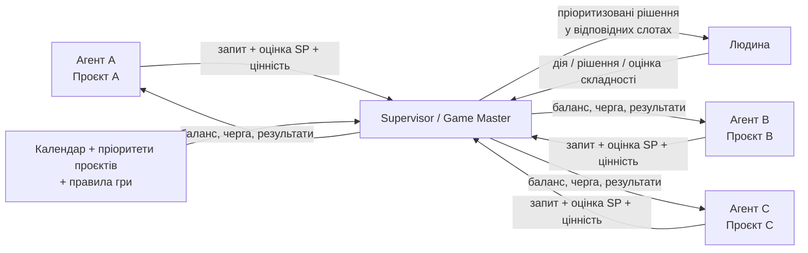
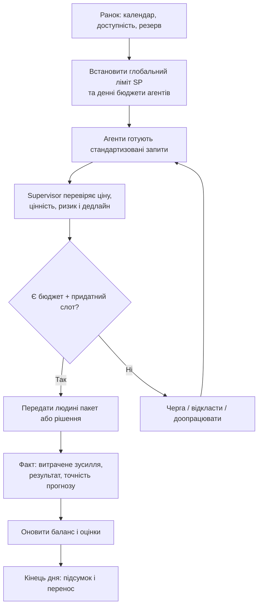
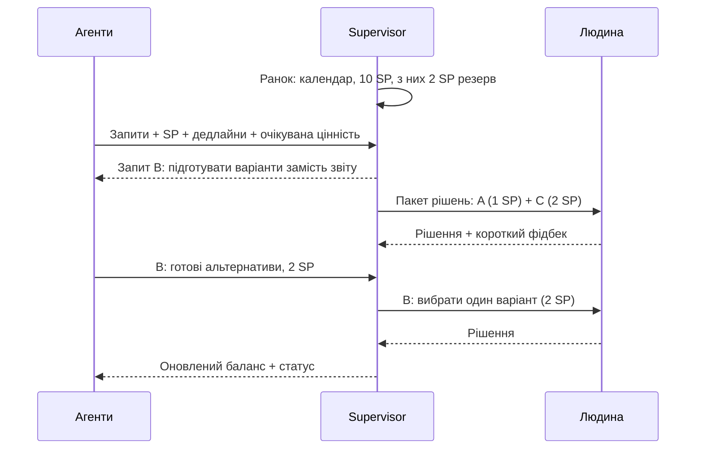

# Agent Attention Game

**Ігрова модель керування увагою людини для мультиагентної AI-системи**  
Версія: 0.1 — концепт для обговорення · 12 жовтня 2026 року  
Статус: **гіпотеза / дизайн-пропозиція, не перевірена практикою**

## 1. Executive summary

У системі працюють незалежні AI-агенти: кожен має контекст свого проєкту, намагається покращувати його бізнес-результат і періодично потребує рішень або дій людини. Агенти не бачать усієї картини, тому можуть одночасно надсилати багато запитів, змагатися за увагу та погіршувати загальну ефективність.

**Пропозиція:** перетворити доступ до уваги людини на обмежений ігровий ресурс — **mana**. Одна взаємодія коштує певну кількість **attention points (SP)** залежно від *когнітивного зусилля*, а не тільки тривалості. Наприклад: просте підтвердження — 1 SP, вибір із готових альтернатив — 2 SP, аналіз звіту — 5 SP.

У систему додається **Supervisor / Game Master**, який знає глобальні пріоритети, календар і правила розподілу, але не мусить володіти повним контекстом усіх проєктів. Він формує денний бюджет уваги, перевіряє оцінки вартості запитів і визначає, що, коли та в якому форматі показувати людині.

**Один робочий день = один раунд гри.** Усередині дня є слоти для швидких, середніх і складних рішень; supervisor перевіряє ситуацію протягом дня. Агенти мають власні бюджети, можуть переносити невитрачений залишок (з обмеженням), тому вчаться планувати звернення, об’єднувати питання та заздалегідь готувати варіанти рішень.

**Головна мета:** підвищити бізнес-цінність на одиницю людської уваги, водночас зменшивши кількість переривань, когнітивне перевантаження та ризик пропустити критичне рішення.

> Важливе розрізнення: **SP — міра когнітивної складності; календарні хвилини — окреме обмеження доступності; бюджет агента — право претендувати на увагу, а не запас енергії людини.**

---

## 2. Візуальна схема системи

### Ролі

| Учасник | Що знає | За що відповідає |
|---|---|---|
| **Проєктний агент** | Детальний контекст власного проєкту | Пропонує дії, готує рішення, оцінює вигоду та когнітивну ціну звернення, управляє власним бюджетом |
| **Supervisor** | Пріоритети проєктів, правила, бюджети, календар, стандартизовані метадані запитів | Приймає/відкладає запити, контролює ціни SP, розподіляє слоти, оновлює бюджет і статистику |
| **Людина** | Деталі лише тих рішень, які справді потрібно прийняти | Ухвалює рішення, виконує необхідні дії, іноді оцінює реальну складність |

Повний контекст між агентами **не синхронізується**. Через supervisor проходять лише стандартизовані описи потрібних взаємодій.

## 3. Ігрові механіки: натхнення з настільних ігор

| Гра | Механіка | Адаптація |
|---|---|---|
| **Terra Mystica** | Обіг обмеженого ресурсу power | Mana для взаємодій, необхідність планувати її використання |
| **Dune: Imperium** | Worker placement: обмежені слоти дій | Вільні вікна для людських рішень різного типу |
| **Power Grid** | Конкуренція за дефіцитні можливості через ставки | Конкуруючі запити агентів; **аукціон — можлива, ще не затверджена механіка** |
| **Barrage** | Ресурси можуть повертатися із затримкою | Можливі cooldown / затримки для дорогих або надмірних звернень — **опція для дослідження** |

Ми **не копіюємо** жодну гру буквально, а використовуємо зрозумілі правила економіки дефіцитного ресурсу.

---

## 4. Правила гри: початкова версія (MVP)

### Правило 1. Раунд і денні цикли

- **Один робочий день — один раунд.** На початку дня supervisor переглядає календар і визначає доступні вікна.
- **Усередині дня — мініцикли**, наприклад, раз на годину: нові запити, зміни календаря, переоцінка черги.
- **Тиждень — стратегічний горизонт:** перенос коштів агентів, аналіз результатів, налаштування правил.
- Низькопріоритетні звернення збираються в пакети, щоб уникнути десятків окремих переривань.

### Правило 2. Два незалежні обмеження: увага та час

1. **Attention capacity (SP/день).** Когнітивне навантаження, яке людина готова витратити на агентські рішення.
2. **Calendar capacity (вікна/хвилини).** Коли фізично можлива взаємодія.

Календар сам по собі **не дозволяє математично вивести SP**: 20 вільних хвилин після шести зустрічей можуть бути гіршими для складного рішення, ніж 20 хвилин зранку. Тому в MVP пропонується:

- Зчитувати лише доступність/busy-вікна; деталі приватних зустрічей не потрібні.
- На старті використовувати **ручний денний ліміт**, наприклад 10 SP, і кілька відведених вікон; це **тестове припущення**, не норма.
- Частину глобального ліміту й часу **резервувати** для непередбачуваних ситуацій (наприклад 20–30% — параметр експерименту).
- Перераховувати доступність, коли змінюється календар; не «відбирати» уже погоджені дії без пояснення.
- Через 2–4 тижні скоригувати ліміт за фактичним навантаженням і фідбеком людини.

### Правило 3. Вартість контакту оцінюємо як story points

| Клас | Приклад дії людини | Початкова ціна |
|---|---|---:|
| XS | Підтвердити готове рішення «так/ні», маючи достатній контекст | 1 SP |
| S | Вибрати з 2–3 добре підготовлених варіантів | 2 SP |
| M | Дати змістовний короткий фідбек | 3 SP |
| L | Ознайомитися зі звітом, проаналізувати й ухвалити рішення | 5 SP |
| XL | Глибокий розбір неоднозначної ситуації | 8 SP |

Це **гіпотези для калібрування**, а не універсальні тарифи. Категорія визначається **реальною розумовою роботою людини**, а не формулюванням питання. Наприклад, «підтвердь так/ні після читання звіту на 25 сторінок» — не 1 SP.

**Послідовність оцінки:** агент пропонує SP → supervisor перевіряє на підставі типу запиту, доданих доказів та історії → після виконання система інколи запитує дуже коротку оцінку людини («легше / як очікувалося / складніше») → майбутні ціни уточнюються.

При цьому **SP і терміновість — різні змінні**: критичне рішення може бути простим на 1 SP, а некритичне — складним на 8 SP.

### Правило 4. Бюджети агентів і накопичення

- Кожен агент одержує **денний грант** `Gᵢ` mana; його величина може залежати від глобального пріоритету проєкту.
- Невитрачений залишок можна переносити на наступний робочий день.
- **Стеля переносу = один денний грант агента.** Якщо `Gᵢ = 4`, то агент може принести з попереднього дня максимум 4 mana, а його доступний бюджет після нового гранту — максимум 8.
- Усе, що перевищило стелю переносу, **згорає**.
- Витрата відбувається за **виконану** взаємодію. Запит, який стоїть у черзі, поки що не списує ресурс; для бронювання може знадобитися тимчасове резервування.
- Невитрачена мана агента **не збільшує фізичний денний ресурс людини**: глобальний ліміт і календар продовжують діяти.

Спрощена формула:

`переносᵢ(завтра) = min(Gᵢ, max(0, доступноᵢ(сьогодні) − витраченоᵢ(сьогодні)))`

`доступноᵢ(завтра) = Gᵢ + переносᵢ(завтра)`

**Нюанс:** якщо агент не витратив ману, це не невдача. Система не повинна стимулювати витрачання «щоб не згоріло»; успіх визначається бізнес-результатом і якістю рішень.

### Правило 5. Кожен запит має стандартизований формат

Мінімальні поля об’єкта `InteractionRequest`:

| Поле | Для чого |
|---|---|
| `project_id`, `agent_id` | Ідентифікація проєкту й ініціатора |
| `decision_requested` | Одне чітке питання або дія, потрібна від людини |
| `recommendation` | Підготовлена рекомендація агента та коротка аргументація |
| `options` | Альтернативи, якщо є |
| `estimated_sp` | Оцінка когнітивної вартості |
| `estimated_minutes` | Оцінка часу **окремо від SP** |
| `expected_business_impact` | Очікувана користь або втрати від зволікання, з поясненням припущень |
| `deadline`, `urgency_reason` | Коли і чому необхідне рішення |
| `confidence`, `supporting_evidence` | Упевненість і мінімальні підтвердження для перевірки |
| `can_wait`, `fallback_action` | Що станеться, якщо не звертатися зараз |

Supervisor не повинен вимагати доступу до повного контексту проєкту — лише до достатніх метаданих для справедливого рішення.

### Правило 6. Пріоритизація і розподіл

У базовій версії **Supervisor, а не вільний аукціон**, вибирає запити, беручи до уваги:

1. Глобальний пріоритет проєкту (узгоджений із власником портфеля).
2. Наслідки пропуску дедлайну та незворотність ризику.
3. Очікувану додану цінність дії та впевненість в оцінці.
4. Ціну в SP, потрібні календарні хвилини та тип слота.
5. Історію очікування (щоб маленькі проєкти не голодували безкінечно).

Порядок може спочатку визначатися **прозорими правилами та ручними вагами**, без складної оптимізації. Формулу скорингу, аукціон, ставки та репутацію доцільно додавати лише тоді, коли є дані для перевірки справедливості й стійкості до маніпуляцій.

**Виняток:** реально критичні ситуації (безпека, юридичні чи фінансові ризики, інцидент production) мають окремий канал ескалації й **не блокуються браком мани**. Факт перевищення фіксується, щоб система залишалася вимірюваною.

### Правило 7. Агенти мають економити людську увагу

Агент отримує вигоду, коли перетворює складне прохання на готове рішення:

- Погано: «Прочитай 20-сторінковий звіт та скажи, що робити» — умовно 5 SP.
- Краще: «Я проаналізував звіт, пропоную варіант B, ось 3 ризики й альтернативи; підтверди або вибери інший» — умовно 1–2 SP **якщо людина справді може безпечно ухвалити рішення без додаткового аналізу**.

Не можна «знизити ціну» лише зміною формулювання. Для важливих рішень слід вимагати перевірювану аргументацію, а не автоматично натискати «так».

### Правило 8. Навчання на фактичному навантаженні

Після виконання supervisor записує:

- прогнозний SP і скоригований фактичний SP (за коротким фідбеком / вибірковим аудитом);
- приблизні фактичні хвилини та кількість переключень контексту;
- чи було рішення вчасним і корисним;
- наскільки коректно агент оцінив терміновість та очікуваний ефект.

На перших етапах **не запитувати фідбек після кожної взаємодії**: інакше сам процес вимірювання витрачатиме увагу. Використовувати вибірку, аномалії та короткий щоденний підсумок. Штрафи за помилкові прогнози й репутаційні коефіцієнти — можливе розширення, не правило MVP.

---

## 5. Приклад одного ігрового дня

**Припущення для демонстрації:** глобальний доступний бюджет людини — **10 SP**, 2 SP з них у резерві. Три агенти мають достатню ману для своїх запитів. Дедлайни й цінність нижче умовні.

| Агент | Запит | Ціна | Цінність / терміновість | Рішення supervisor |
|---|---|---:|---|---|
| A | Підтвердити критичне рішення про реліз | 1 SP | Висока, сьогодні | Віддати в найближчий швидкий слот |
| B | Прочитати довгий звіт | 5 SP | Невисока, може чекати | Повернути агенту на доопрацювання |
| C | Вибрати один із трьох підготовлених варіантів | 2 SP | Середня/висока | Поставити у слот рішень |
| B | Після доопрацювання: вибрати один із двох варіантів | 2 SP | Невисока, може чекати | Додати до пакета, якщо є місткість |

**Результат демонстрації:** 5 SP на три рішення замість 8 SP на первинні запити (1 + 5 + 2). Решта доступного бюджету не повинна витрачатися заради самого витрачання. Це ілюстрація механіки, **не доказ** реальної економії чи бізнес-ефекту.

---

## 6. Як перевірити, чи це справді працює

Нам потрібно довести **не те, що агенти витрачають менше SP за власними оцінками**, а те, що система реально зменшує людське навантаження **без втрати якості та бізнес-результату**.

### 6.1. Гіпотези

- **H1 — менше переривань:** кількість неочікуваних звернень до людини знижується.
- **H2 — менше когнітивних витрат:** людина оцінює сукупну складність агентських рішень нижче за порівнюваного обсягу роботи.
- **H3 — якість зберігається:** частка своєчасних критичних рішень та якість дій не погіршуються.
- **H4 — агенти краще готують рішення:** зростає частка запитів із рекомендацією й альтернативами, знижується потреба в додатковому аналізі.
- **H5 — справедлива алокація:** високопріоритетні запити отримують увагу першими, але решта проєктів не потрапляє в нескінченну чергу.

### 6.2. Три рівні тестування

**Етап A — симуляція без людини.** Створити умовний портфель із 3–10 агентів, типами завдань, відомою *реальною* складністю, дедлайнами, важливістю проєктів і календарем. Прогнати ті самі сценарії кількома політиками:

1. **Baseline:** агенти надсилають звернення одразу, без координації.
2. **Queue:** supervisor ранжує заявки без мани й накопичення.
3. **Game:** supervisor + SP + бюджети агентів + перенос + слоти.

Важливо: «істинну» цінність і складність задає **симулятор**, а агенти бачать лише неточні оцінки — інакше тест буде самопідтверджувальним. Для відтворюваності використовувати однакові сценарії й випадкові seed у всіх трьох режимах.

**Етап B — shadow mode з реальними запитами.** Протягом 1–2 тижнів supervisor збирає й оцінює звернення, але **не блокує** їх і не керує реальною комунікацією. Порівнюємо, які рішення він поставив би вище, скільки SP прогнозував і що людина відчула фактично.

**Етап C — контрольований пілот.** На некритичних проєктах запустити активний supervisor, залишивши кнопку «обійти чергу» для важливих ситуацій. Порівнювати тижні або випадково обрані однорідні запити з контрольним режимом, враховуючи відмінності у завантаженні та сезонності. Мета — перевірити не лише виграш, а й небажані наслідки.

### 6.3. Метрики успіху

| Метрика | Як вимірювати | Чому важлива |
|---|---|---|
| **Interruptions/day** | Незаплановані повідомлення, які потребують відповіді | Безпосередньо вимірює «шум» |
| **Human effort** | Фактичні хвилини + суб’єктивний рівень складності (окремо) | Не покладатися тільки на самозвіти агентів |
| **Business value delivered** | Погоджена оцінка корисності завершених рішень; за можливості — грошова | Перевіряє, чи не економимо увагу ціною результату |
| **Value per human effort** | Бізнес-цінність / хвилини або калібровані SP людини | Цільова efficiency-метрика |
| **Critical SLA** | Частка критичних рішень до дедлайну | Захист від небезпечних затримок |
| **Preparation quality** | % звернень, де є рекомендація + достатні пояснення | Ознака корисної поведінки агентів |
| **SP calibration** | Помилка між прогнозними й оціненими після виконання SP | Чи працює planning-poker-подібна шкала |
| **Fairness / starvation** | Час очікування за проєктом та пріоритетом | Щоб невеликі проєкти не випадали з системи |
| **Human satisfaction** | Коротке тижневе опитування | Суб'єктивне відчуття контролю й навантаження |

Для експерименту можна попередньо задати орієнтири, наприклад **мінус 30% непланових переривань**, не гірша своєчасність критичних рішень і не гірша якість роботи. Це **критерії, які пропонується перевірити**, а не очікуваний гарантований результат.

### 6.4. Тести на «поломку гри» (adversarial testing)

Окремо симулювати ситуації, коли:

- усі агенти оголошують свої запити терміновими;
- агенти завищують очікувану бізнес-цінність;
- агенти навмисно дроблять одне велике питання на дрібні «1 SP»;
- агент накопичує бюджет і робить сплеск запитів у п’ятницю;
- календар раптово заповнюється зустрічами;
- маленький проєкт тижнями не отримує уваги;
- людина втомлена, а в календарі формально є вільне вікно;
- рішення виглядає як «так/ні», але приховує значний ризик.

Якщо система погано проходить хоча б один критичний сценарій, правила треба змінити **до** розширення пілота.

### 6.5. Мінімальний експеримент, який можна зробити першим

1. Взяти **3 агентів**, кожен зі своїм набором завдань, і **1 supervisor**.
2. Зібрати **30–50 реалістичних заявок**: прості підтвердження, вибір, читання звітів, термінові кейси.
3. Для кожної заявки зафіксувати незалежну контрольну оцінку реальної складності, важливості та крайнього терміну.
4. Симулювати **20 робочих днів** з різними календарями та лімітами уваги.
5. Порівняти baseline, просту чергу та ігрову економіку за метриками з таблиці.
6. На результатах вирішити, чи має сенс реальний shadow-пілот.

Це дасть перший об'єктивний сигнал без необхідності одразу інтегруватися з календарем і реально турбувати людину.

---

## 7. Що вже узгоджено, а що ще відкрите

### Узгоджений концептуальний напрям

- Людська увага — дефіцитний ресурс.
- Ціна звернення залежить від когнітивної складності; шкала на кшталт planning poker.
- Є supervisor із глобальними пріоритетами без повного контексту проєктів.
- Один день — один раунд, протягом дня є мініцикли й слоти.
- Календар впливає на доступність, а оцінки SP уточнюються за фактичним досвідом.
- Агенти зацікавлені готувати рішення, а не скидати аналітичну роботу на людину.
- Перенос невикористаної мани дозволений, орієнтовна стеля — **один денний грант**.

### Відкриті питання, які треба перевірити

1. Як правильно калібрувати **SP відносно втоми, складності, ризику та фактичних хвилин**?
2. Як встановлювати **денний глобальний ліміт**: вручну, за календарем, за історією чи комбіновано?
3. Чи потрібен **аукціон ставок**, чи вистачить supervisor і правил пріоритизації?
4. Як формувати **денні гранти агентів** і не дискримінувати малі проєкти?
5. Чи зберігати **репутацію агентів** за точність прогнозів, і як уникнути несправедливих штрафів?
6. Що рахувати **бізнес-цінністю**, якщо проєкти мають різні й несумірні KPI?
7. Як гарантувати, що економія SP **не погіршить якість або безпеку рішень**?

## 8. Рекомендована наступна ітерація

**Не починати з аукціону.** Спершу реалізувати невеликий симулятор із трьома режимами (baseline / queue / game), стандартизованим форматом запиту, шкалою SP, денним глобальним лімітом, персональними грантами та переносом. Якщо «гра» не показує переваги над звичайною чергою, ускладнювати економіку ставками, reputation і cooldown поки недоцільно.

**Головний критерій:** чи дає ігрова механіка *додаткову* користь порівняно з простим і прозорим розкладом задач за пріоритетами? Саме це має вирішити тест.
